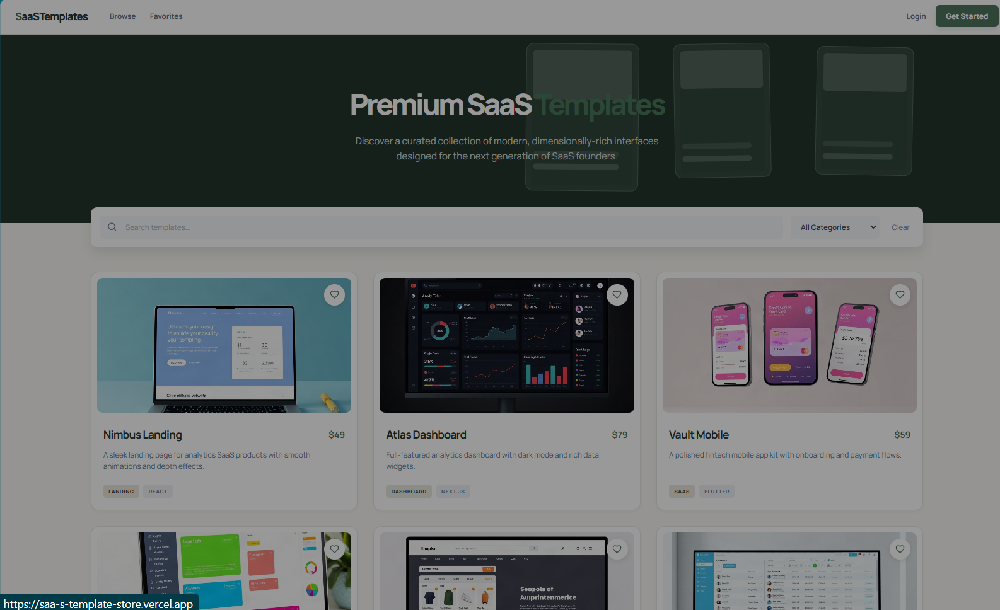
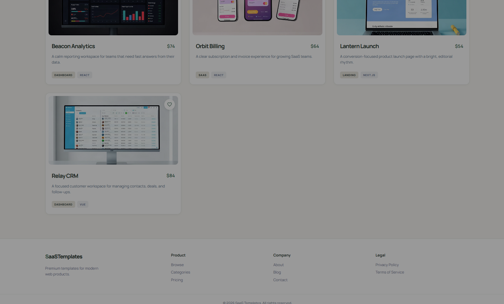
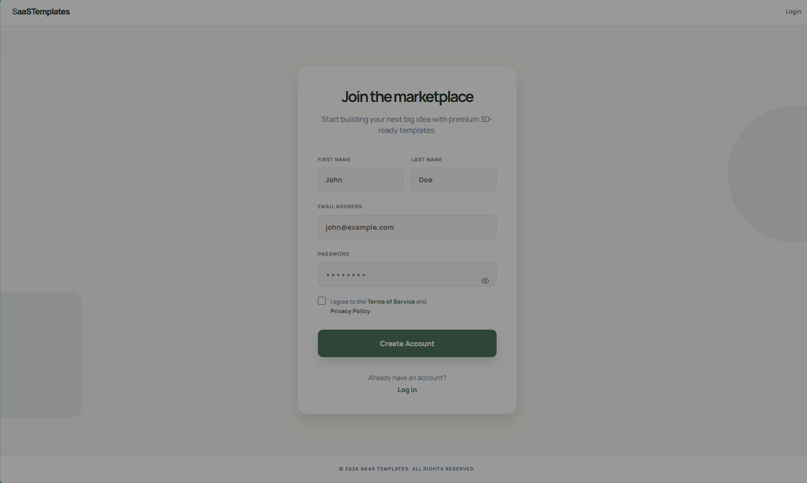

# SaaSTemplates

## Premium SaaS template marketplace

SaaSTemplates is a bright, responsive marketplace for discovering and saving polished SaaS interface templates. The project combines a React/Vite frontend with an Express/MongoDB API, JWT authentication, searchable catalog data, and persistent favorites.

## Product preview

The screenshots below show the live marketplace experience, catalog cards, and account registration flow.







## What is included

- Responsive marketplace homepage with a layered, depth-focused visual style
- Ten seeded SaaS templates using the supplied thumbnail artwork
- Search by template name and description
- Category filtering with a clear-filters action
- Authenticated favorites with add/remove controls
- Favorite state persisted through the API and local browser session
- JWT registration and login flows with bcrypt password hashing
- Password visibility controls, validation messages, logout, and protected routes
- SPA navigation for marketplace, login, signup, and favorites pages
- API aliases for both `/api/...` and the shorter root route format
- Render API configuration and Vercel SPA fallback configuration

## Technology

| Layer | Tools |
| --- | --- |
| Frontend | React, Vite, React Router, Axios, JavaScript, CSS, Lucide React |
| Backend | Node.js, Express, Mongoose, MongoDB, JWT, bcryptjs |
| Quality | Vitest, Supertest, mongodb-memory-server |
| Hosting | Vercel for the client, Render for the API |

## Project layout

```text
client/
  public/templates/       supplied template thumbnails
  src/components/         reusable UI components
  src/context/            authentication and session state
  src/pages/              marketplace, auth, and favorites screens
  src/services/           API client and request helpers
server/
  src/controllers/        request handlers
  src/models/             MongoDB models
  src/routes/             API routes
  src/utils/seed.js       catalog seed data
docs/screenshots/         README product screenshots
render.yaml               Render service configuration
```

## Run locally

Requirements: Node.js 18 or newer and a MongoDB database, either local or MongoDB Atlas.

### 1. Start the API

```powershell
cd server
npm install
Copy-Item .env.example .env
```

Update `server/.env` with a MongoDB connection string and a long random `JWT_SECRET`, then seed the catalog and start the server:

```powershell
npm run seed
npm run dev
```

The API runs at `http://localhost:5000`.

### 2. Start the frontend

Open a second terminal:

```powershell
cd client
npm install
Copy-Item .env.example .env
npm run dev
```

The frontend runs at `http://localhost:5173`. Set `VITE_API_URL` in `client/.env` to the API origin, for example:

```text
VITE_API_URL=http://localhost:5000
```

`VITE_API_URL` is a public client configuration value; never put database credentials or JWT secrets in a `VITE_*` variable.

## Add and seed templates

The catalog is defined in [server/src/utils/seed.js](server/src/utils/seed.js). To add a template, append an object to the `templates` array:

```js
{
  name: "New Template",
  description: "A short description for the marketplace card.",
  thumbnail_url: "/templates/atlas-dashboard.jpg",
  category: "SAAS",
  price: 69,
  technology: "REACT",
  added: "ADDED TODAY"
}
```

Use a unique template name. If you add a new thumbnail, place it in `client/public/templates/` and commit it with the seed change. Then run:

```powershell
cd server
npm run seed
```

The seed command updates templates by name and inserts new templates without wiping custom records. Render is configured to run the same seed command during deployment, so pushing a catalog change to `main` reseeds the production catalog automatically.

## Application routes

| Route | Description |
| --- | --- |
| `/` | Marketplace home |
| `/templates` | Marketplace catalog |
| `/login` | Login form |
| `/register` | Registration form |
| `/signup` | Registration alias |
| `/favorites` | Authenticated favorites |

## API reference

Successful responses use `{ success: true, data }`; errors use `{ success: false, message }`.

| Method | Endpoint | Auth | Purpose |
| --- | --- | --- | --- |
| GET | `/api/health` | No | Check API status |
| POST | `/api/auth/register` | No | Create a user and return a JWT |
| POST | `/api/auth/login` | No | Authenticate a user and return a JWT |
| GET | `/api/templates?search=&category=` | No | List and filter templates |
| GET | `/api/templates/:id` | No | Return one template |
| GET | `/api/favorites` | Bearer JWT | List the current user's favorites |
| POST | `/api/favorites/:templateId` | Bearer JWT | Add a favorite |
| DELETE | `/api/favorites/:templateId` | Bearer JWT | Remove a favorite |

## Deploy

### Render API

1. Create a Render web service from this repository.
2. Use the `server` directory as the service root.
3. Configure `MONGODB_URI`, `JWT_SECRET`, and `CLIENT_URL` in Render.
4. Use the build command `npm install && npm run seed`.
5. Use the start command `npm start`.

### Vercel frontend

1. Import the repository into Vercel.
2. Set the project root to `client`.
3. Set `VITE_API_URL` to the Render API origin.
4. Deploy and verify that `/`, `/templates`, `/login`, `/signup`, and `/favorites` load correctly.

The committed `client/vercel.json` keeps client-side routes working after a refresh.

## Verification

```powershell
cd client
npm run build

cd ../server
npm test
```

The API tests use `mongodb-memory-server`. Its first run may download a MongoDB test binary.

## Contact

Built and maintained by **Raagul**.

- Email: [nraagul@gmail.com](mailto:nraagul@gmail.com)
- GitHub: [github.com/iaamraagul](https://github.com/iaamraagul)

## License

This project is provided as a portfolio and learning project. Add a project-specific license before redistributing it commercially.
